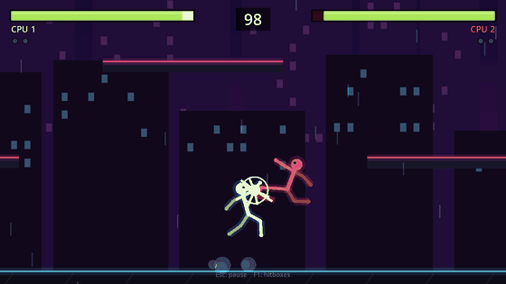
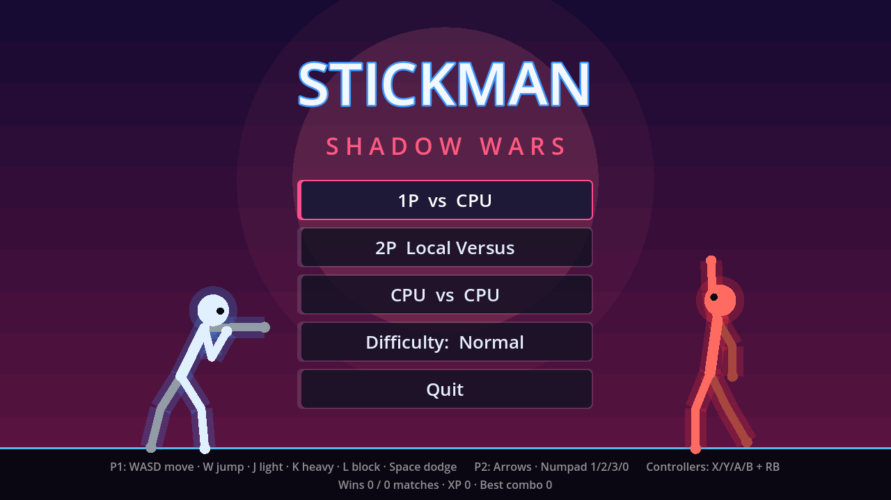
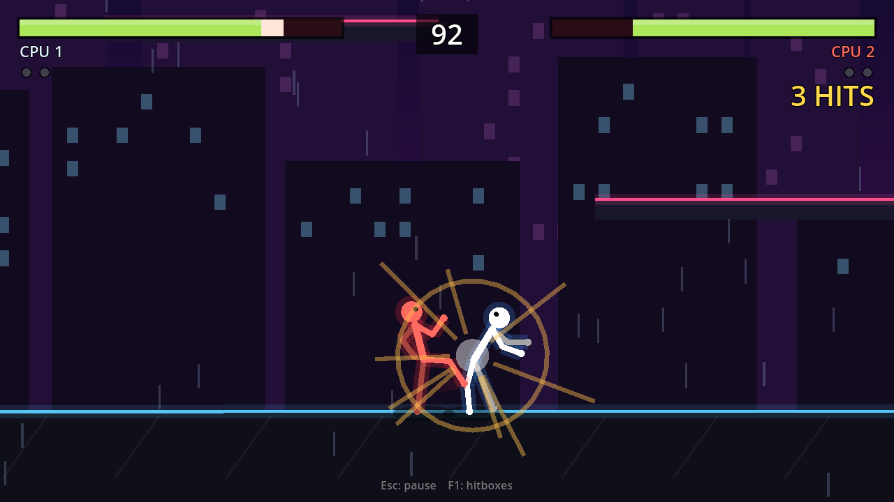
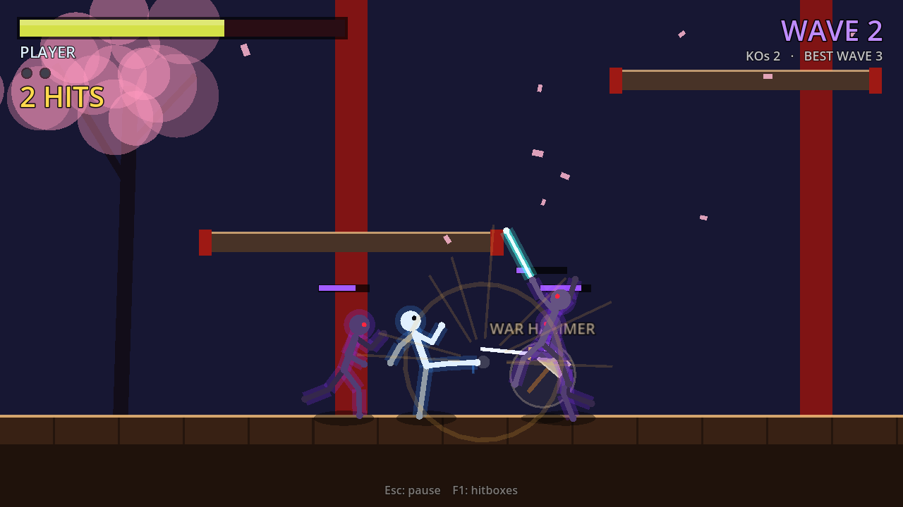
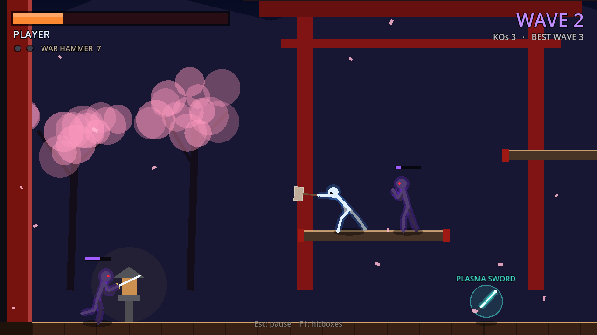
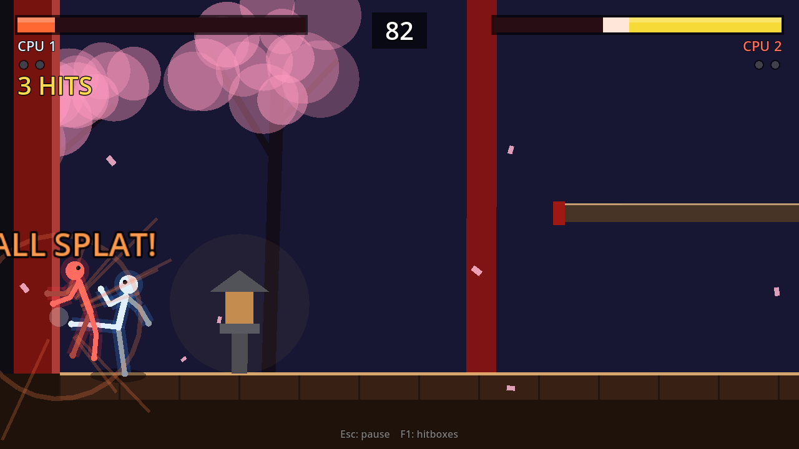
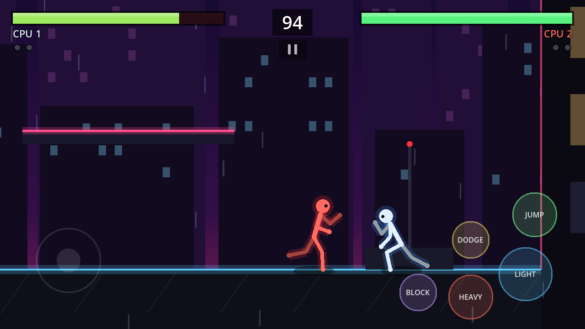
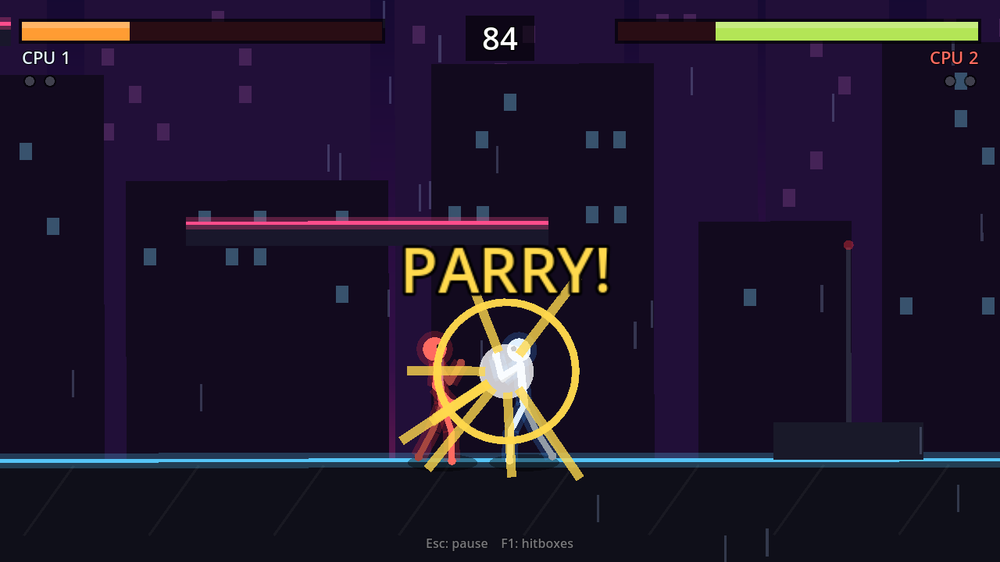

<div align="center">

# 🥷 Stickman: Shadow Wars

**A fast, juicy 2D stickman fighting game built in Godot 4. Play on Windows, Linux, Android or right in your browser.**

Chain combos, parry on the frame, roll through attacks, grab a katana or a war hammer, juggle off a launcher, survive endless waves of shadow fighters and send them flying as ragdolls.

[](https://github.com/jaineil32624/stickman-shadow-wars-/actions/workflows/build.yml)




## ⬇️ Download and play

<a href="https://github.com/jaineil32624/stickman-shadow-wars-/raw/main/downloads/StickmanShadowWars.apk"></a>
<a href="https://github.com/jaineil32624/stickman-shadow-wars-/raw/main/downloads/StickmanShadowWars-windows.zip"></a>
<a href="https://jaineil32624.github.io/stickman-shadow-wars-/"></a>
<br>
<a href="https://github.com/jaineil32624/stickman-shadow-wars-/raw/main/downloads/StickmanShadowWars-linux.zip"></a>
<a href="https://github.com/jaineil32624/stickman-shadow-wars-/archive/refs/heads/main.zip"></a>
<a href="https://github.com/jaineil32624/stickman-shadow-wars-/raw/main/downloads/StickmanShadowWars-web.zip"></a>

</div>

| Platform | How to run |
| --- | --- |
| 🤖 **Android** | Tap the APK button on your phone, open the file, allow "install unknown apps", install |
| 🪟 **Windows** | Unzip, run `StickmanShadowWars.exe` (if SmartScreen appears: More info → Run anyway) |
| 🌐 **Browser** | Click Play Now. Works on desktop and phone browsers |
| 🐧 **Linux** | Unzip, `chmod +x StickmanShadowWars.x86_64`, run |
| 🛠️ **Godot** | Unzip the project, open `project.godot` in Godot 4.3+, press F5 |

## Screenshots

| Title screen | Combat |
| --- | --- |
|  |  |
| **Arena Survival** | **Weapons** |
|  |  |
| **Moonlit Dojo** | **Mobile touch controls** |
|  |  |
| **Perfect parry** | |
|  | |

## Features

**Combat core**
- Light combo string (jab → cross → roundhouse) with buffered inputs, so mid-combo presses always come out
- Heavy attacks, a down+heavy **launcher**, **dash strikes** out of a run or a dodge roll
- **Air combos**: flying kick → spinning kick → diving slam that spikes opponents into the floor
- Jump-cancel a launcher on hit to chase your opponent into the air
- **Blocking** with chip damage and blockstun, plus a frame-tight **perfect parry** that staggers the attacker and turns your next hit into a 1.5× **counter**
- **Dodge roll** and directional **air dodge** with invincibility frames; tech-roll out of a knockdown
- Knockback that grows as health drops, combo hitstun decay (no infinites), floor bounces, knockdowns and **wall splats**
- Damage visibly affects movement: hurt fighters slouch and move slower

**Weapons**
- Weapon drops fall into the arena: **Katana**, **War Hammer**, **Spear** and **Plasma Sword**
- Each has its own moveset: reach, speed, damage, knockback, and slashes in place of kicks
- Weapons wear down and **break** after enough hits; KO'd fighters drop theirs
- Toggle weapon drops from the menu

**Feel and presentation**
- Fully procedural stick-figure animation: every move is a pose that the rig blends into, with a run cycle, idle breathing and flips
- **Verlet ragdoll** knockouts that collide with the arena
- Hitstop, hit flashes, impact sparks, shock rings, motion trails, dust, screen shake and **slow-motion KO punch-ins**
- Procedurally synthesised sound effects (no audio files needed)
- Two arenas: **Neon Rooftop** (parallax city, rain) and **Moonlit Dojo** (torii gate, cherry trees, drifting petals), or pick Random

**Modes and AI**
- 1P vs CPU, 2P local versus, CPU vs CPU (best of three rounds, 99-second timer)
- **Arena Survival**: endless waves of shadow stickmen that get tougher, smarter and armed; heal between waves, beat your best wave
- CPU with **Easy / Normal / Hard / Nightmare** difficulty: reaction time, blocking, parrying, rolling, whiff punishing, anti-airs, combo follow-ups, movement prediction, simple habit adaptation, grabbing weapons, and **teaming up** in group fights (one brawls while the others circle)
- Saved profile (wins, XP, best combo, best survival wave)

**Platforms and input**
- Keyboard, up to two controllers, and on-screen touch controls on phones and tablets
- Landscape mobile layout, GL Compatibility renderer for low-end devices

## Controls

| Action | Player 1 | Player 2 | Controller | Touch |
| --- | --- | --- | --- | --- |
| Move | A / D | ← / → | Left stick / D-pad | Left-side joystick |
| Jump (double jump in air) | W | ↑ | A | JUMP |
| Light attack | J | Numpad 1 | X | LIGHT |
| Heavy attack | K | Numpad 2 | Y | HEAVY |
| Block (tap just before a hit to **parry**) | L | Numpad 3 | RB / LB / RT | BLOCK |
| Dodge roll / air dodge | Space | Numpad 0 | B | DODGE |
| Launcher | S + K | ↓ + Numpad 2 | Down + Y | Joystick down + HEAVY |
| Drop through platform | S + W | ↓ + ↑ | Down + A | Joystick down + JUMP |
| Pause | Esc | Esc | Start | ❚❚ button |

Press **F1** to show hitboxes.

### Combo starters

- `J J J`: three-hit ground string
- `J J ↓K`: launcher, then `W` to jump-cancel and `J J K` in the air
- Dodge then `J`: dash strike
- Parry (tap block as a hit lands), then anything: counter for 1.5× damage

## Architecture

The slice is built so the rest of the design can grow on top of it without rewrites.

```
scripts/
├── autoload/          InputSetup (all bindings), GameState (settings + save), CombatBus (events), Sfx
├── combat/            AttackData (frame data), MoveLibrary (movesets), WeaponData + WeaponLibrary
├── fighter/           Fighter (physics, health, hit resolution), StickRig (procedural body + ragdoll)
│   ├── state_machine.gd, fighter_state.gd
│   └── states/        ground, air, attack, block, dodge, air_dodge, hitstun, knockdown, recover, ko
├── input/             FighterInput (base), PlayerInput (keyboard/pad/touch)
├── ai/                AIInput (CPU brain with difficulty profiles)
├── game/              Battle (shared base: juice, pause, weapon drops), Match (versus), Survival, Arena, MatchCamera, WeaponPickup
├── fx/                Effects (sparks, dust, rings, popups)
└── ui/                Hud, TouchControls, MainMenu, UiStyle
```

- **State machine.** Each behaviour is one `FighterState` script registered in `Fighter.STATES`. A grab, an ability cast or a finisher is a new file plus one line.
- **Data-driven moves.** Attacks are `AttackData` resources (startup/active/recovery, hitbox, damage, knockback, chains, poses). A weapon is a different moveset dictionary or folder of `.tres` files, not new fighter code.
- **Input abstraction.** Fighters only read a `FighterInput`. Keyboard, controllers, touch and the CPU all produce the same intents, and a networked peer will be one more subclass, which keeps the code multiplayer-ready.
- **Event bus.** Fighters emit `CombatBus` events. Effects, sound, camera, HUD and future achievements/stats listen without coupling.
- **Frame-based combat.** Timings are counted in 60 Hz physics frames, which keeps combat deterministic and rollback-friendly.

## Building

GitHub Actions (`.github/workflows/build.yml`) runs a headless CPU-vs-CPU smoke test on every push, then exports **Windows, Linux, Android (APK) and Web**. Builds are attached to each run as artifacts.

- **Release:** push a tag such as `v0.1.0` and the workflow publishes a GitHub Release with all downloads.
- **Play in the browser:** in the repo go to *Settings → Pages → Source: GitHub Actions* once. Every push to `main` then deploys the web build.

Local export: install Godot 4.3 export templates, then `Project → Export`. Android export needs an Android SDK path and debug keystore in *Editor Settings → Export → Android*.

Handy command-line flags (after `--`): `--autoplay` starts a CPU vs CPU match (add `--survival`, `--dojo` or `--rooftop`), `--log` prints combat events, `--touch` forces touch controls, `--shot=<frame>:<file.png>` saves a screenshot.

## Roadmap

This is the playable vertical slice of a much larger design. See [ROADMAP.md](ROADMAP.md) for what is done and what comes next (weapons, elemental powers, story mode, online multiplayer, more arenas and Steam features).

## License

[MIT](LICENSE)
